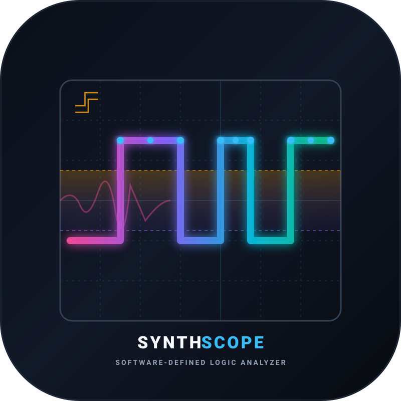

<p align="center">
  
</p>

<h1 align="center">SynthScope</h1>

<p align="center">
  <strong>The Open-Source, Software-Defined Digital Logic Analyzer & Protocol Simulator.</strong>
</p>

<p align="center">
  <a href="LICENSE"></a>
  
  
  
  <a href="future.md"></a>
</p>

---

## ⚡ What It Does

SynthScope eliminates the $100+ hardware dependency for ECE students and embedded firmware developers by providing a robust, browser-based engineering sandbox to simulate, manipulate, and decode digital communications.

1. **Physical Layer Simulation:** Synthesizes UART protocol transmissions as continuous analog waveforms, injecting realistic Gaussian noise to simulate transmission line impedance and EMI.
2. **Software Signal Conditioning:** Processes noisy signals through a customizable software Schmitt Trigger, utilizing dual-threshold hysteresis ($V_{TH} / V_{TL}$) to eliminate chattering and extract clean binary logic.
3. **Professional Export Integration:** Generates IEEE 1364 VCD (Value Change Dump) files on the fly, allowing virtual signal captures to be loaded directly into industry-standard desktop viewers like GTKWave or PulseView.

---

## 🏗️ Repository Architecture

```plaintext
/synthscope-monorepo
├── /frontend               # Next.js (App Router), Tailwind, Canvas components
├── /backend                # FastAPI (Async), WS Hub, ECE Logic Engine
├── /common-schemas         # The source of truth for all JSON payloads
└── /.agents                # Antigravity IDE context directory
    └── /rules              # Domain-specific constraints for AI agents
```

*Frontend: Next.js / Canvas API | Backend: FastAPI / Python Math Engine | Telemetry: Novus.ai*

---

## 🚀 How to Run Locally

### 1. Start the ECE Backend (Python)
```bash
cd backend
python -m venv venv
source venv/bin/activate
pip install -r requirements.txt
uvicorn main:app --reload --port 8000
```

### 2. Start the Frontend (Next.js)
```bash
cd frontend
npm install
npm run dev
```

The application will be available at `http://localhost:3000`. No hardware flashing or USB serial drivers are required.

---

## 🔮 Engineering Roadmap

Interested in the architectural transition to WebAssembly (Rust DSP kernel), WebGPU rendering, multi-protocol decoding (SPI, I2C, CAN), and edge RP2040 logic probes? Read the comprehensive [future.md](future.md).

---

## 📄 License

This project is licensed under the **MIT License** — see the [LICENSE](LICENSE) file for details.
